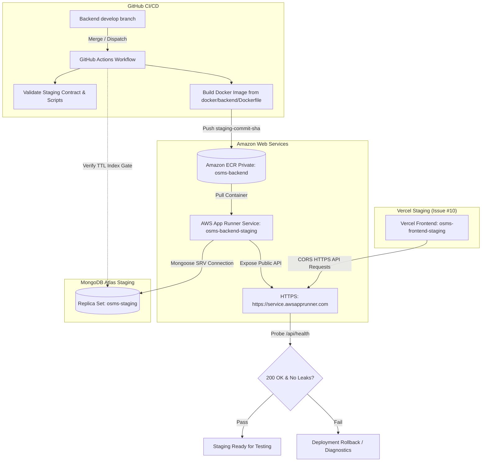

# OSMS Backend Staging Deployment & Automation Runbook (Issue #9)

## 1. Overview & Architecture

This document defines the staging deployment procedure, automation architecture, cloud configuration, and operational rollback instructions for the **Darshana Opticals OSMS Backend**, per SDS Section 7 (Deployment Design) and Issue #9 (DDP-082).

The staging deployment runs an automated, secure pipeline from backend source code to cloud hosting on **AWS App Runner**, backed by **Amazon ECR** and **MongoDB Atlas**.



---

## 2. GitHub Actions Secrets Reference

Before running automated deployments, configure the following secrets in the `infra` repository under **Settings → Secrets and variables → Actions** (or within the `staging` Environment):

| Secret Name | Required | Purpose / Example Value |
| :--- | :--- | :--- |
| `AWS_ACCESS_KEY_ID` | **Yes** | AWS IAM deployment user access key (e.g., `AKIA...`). |
| `AWS_SECRET_ACCESS_KEY` | **Yes** | AWS IAM deployment user secret access key. |
| `AWS_REGION` | **Yes** | Target AWS region (e.g., `ap-southeast-1`). |
| `ECR_REPOSITORY` | Optional | ECR repository name (defaults to `osms-backend`). |
| `APP_RUNNER_SERVICE_ARN` | **Yes** | Staging App Runner service ARN (`arn:aws:apprunner:...`). |
| `BACKEND_REPO_ACCESS_TOKEN`| Optional | Personal Access Token with `repo` scope to clone private backend repo (fallback to `github.token`). |
| `MONGODB_URI` | **Yes** | Staging MongoDB Atlas SRV URI for TTL deployment gate (`osms-staging`). |
| `FRONTEND_ORIGIN` | Optional | Approved staging frontend origin (defaults to `https://osms-frontend-staging.vercel.app`). |

> **Security Rule:** Never commit plaintext secret values or credentials to Git, logs, or Docker images.

---

## 3. Step-by-Step AWS Console Provisioning Guide

For developers configuring AWS for the first time, follow these exact click-by-click steps.

### Step 3.1: Create IAM Deployment User & Access Keys

1. Log in to the [AWS Management Console](https://console.aws.amazon.com/).
2. In the top search bar, search for **IAM** and click **IAM**.
3. In the left navigation menu, click **Users**, then click **Create user**.
4. **User details:**
   - User name: `osms-github-deployer`
   - Leave "Provide user access to the AWS Management Console" **unchecked** (programmatic CLI access only).
   - Click **Next**.
5. **Set permissions:**
   - Select **Attach policies directly**.
   - Attach or create a policy with permissions for:
     - `AmazonEC2ContainerRegistryPowerUser` (to authenticate, push, and describe ECR images).
     - An inline policy for App Runner:
       ```json
       {
         "Version": "2012-10-17",
         "Statement": [
           {
             "Effect": "Allow",
             "Action": [
               "apprunner:UpdateService",
               "apprunner:DescribeService",
               "apprunner:StartDeployment",
               "apprunner:ListOperations"
             ],
             "Resource": "*"
           }
         ]
       }
       ```
   - Click **Next**, review, and click **Create user**.
6. **Generate Access Keys:**
   - Click on the newly created user `osms-github-deployer`.
   - Go to the **Security credentials** tab.
   - Scroll to **Access keys** and click **Create access key**.
   - Select **Command Line Interface (CLI)**.
   - Check the confirmation box and click **Next**.
   - Click **Create access key**.
   - **Important:** Copy the **Access key ID** and **Secret access key**. Store them safely in your password manager and immediately add them to GitHub Secrets.

---

### Step 3.2: Create Private Amazon ECR Repository

1. In the AWS Console search bar, search for **ECR** and select **Elastic Container Registry**.
2. Select your target region (e.g., `Asia Pacific (Singapore) ap-southeast-1`).
3. Click **Create repository**:
   - Visibility: **Private**.
   - Repository name: `osms-backend`.
   - Tag immutability: **Enabled** (Mandatory per AC2: prevents overwriting tags).
   - Scan on push: **Enabled** (Automated vulnerability detection).
4. Click **Create repository**.
5. Note the repository URI: `<AWS_ACCOUNT_ID>.dkr.ecr.<AWS_REGION>.amazonaws.com/osms-backend`.

---

### Step 3.3: Create App Runner ECR Access IAM Role

AWS App Runner needs permission to pull container images from your private ECR repository:

1. Navigate to **IAM** → **Roles** → **Create role**.
2. Select **Custom trust policy** and paste:
   ```json
   {
     "Version": "2012-10-17",
     "Statement": [
       {
         "Effect": "Allow",
         "Principal": {
           "Service": "build.apprunner.amazonaws.com"
         },
         "Action": "sts:AssumeRole"
       }
     ]
   }
   ```
3. Click **Next**.
4. In permissions, search for and select: `AWSAppRunnerServicePolicyForECRAccess`.
5. Click **Next**.
6. Role name: `AppRunnerECRAccessRole`.
7. Click **Create role**.

---

### Step 3.4: Create AWS App Runner Staging Service

1. Search for **App Runner** in the AWS Console search bar and select **AWS App Runner**.
2. Click **Create service**.
3. **Step 1: Source and deployment:**
   - Repository type: **Container registry**.
   - Provider: **Amazon ECR**.
   - Container image URI: Click **Browse** and select `osms-backend` with the initial image tag (e.g. `staging-<commit-sha>`), or paste your initial image URI.
   - Deployment trigger: **Manual** (automated deployment is controlled via GitHub Actions workflow).
   - ECR access role: Select **Choose an existing service role** → `AppRunnerECRAccessRole`.
   - Click **Next**.
4. **Step 2: Configure service:**
   - Service name: `osms-backend-staging`.
   - Virtual CPU: `1 vCPU`.
   - Virtual Memory: `2 GB`.
   - Port: `5000`.
   - **Environment variables:** Add the variables specified in [`environments/staging.env.example`](../environments/staging.env.example):
     - `NODE_ENV`: `production`
     - `PORT`: `5000`
     - `MONGODB_URI`: `mongodb+srv://osms_staging_app:<PASSWORD>@<cluster>.mongodb.net/osms-staging?retryWrites=true&w=majority`
     - `JWT_SECRET`: `<high-entropy-secret>`
     - `JWT_EXPIRES_IN`: `24h`
     - `FRONTEND_ORIGIN`: `https://osms-frontend-staging.vercel.app`
     - `FRONTEND_URL`: `https://osms-frontend-staging.vercel.app`
     - `PAYHERE_MODE`: `sandbox`
     - `PAYHERE_MERCHANT_ID`: `<sandbox-merchant-id>`
     - `PAYHERE_MERCHANT_SECRET`: `<sandbox-merchant-secret>`
     - `GEMINI_API_KEY`: `<gemini-staging-api-key>`
     - `GEMINI_MODEL`: `gemini-flash-lite-latest`
     - *(Refer to Section 3.1 of staging runbook for optional variables)*.
5. **Health check:**
   - Protocol: `HTTP`
   - Path: `/api/health`
   - Interval: `10` seconds
   - Timeout: `5` seconds
   - Healthy threshold: `1`
   - Unhealthy threshold: `3`
6. Click **Next**, review the configuration, and click **Create & deploy**.
7. Once created, App Runner displays the **Service ARN** (copy to GitHub Secrets as `APP_RUNNER_SERVICE_ARN`) and the **Default domain** (e.g., `https://abc123xyz.ap-southeast-1.awsapprunner.com`).

---

## 4. GitHub Actions Deployment Automation

The deployment workflow is implemented in [`.github/workflows/backend-staging-deploy.yml`](../.github/workflows/backend-staging-deploy.yml).

### 4.1 Deployment Trigger Methods

#### Method A: Automatic Continuous Deployment (On Merge)
When a backend Pull Request merges to `develop`, the backend repository emits a `repository_dispatch` event of type `backend-deploy`. The deployment workflow automatically:
1. Clones backend code at the merged commit.
2. Validates staging baseline test contracts.
3. Builds the Docker container with immutable tag `staging-<commit-sha>`.
4. Pushes to Amazon ECR.
5. Verifies the Chatbot TTL index on MongoDB Atlas staging.
6. Updates AWS App Runner with the new container image.
7. Performs automated HTTPS health check and CORS preflight verification.

#### Method B: Manual Dispatch (On Demand / Rollback)
1. In the `infra` GitHub repository, navigate to **Actions**.
2. Select **Backend Staging Deployment & Automation**.
3. Click **Run workflow**:
   - `backend_ref`: Specify `develop` or any target Git commit SHA (e.g., `a1b2c3d4`).
4. Click **Run workflow**.

---

## 5. Staging Health, CORS, and Security Verification

Once deployed, verify the staging service manually or via automated scripts:

### 5.1 Automated Script Verification
```bash
export STAGING_SERVICE_URL="https://<app-runner-id>.<region>.awsapprunner.com"
export FRONTEND_ORIGIN="https://osms-frontend-staging.vercel.app"

node scripts/verify-staging-health.cjs
```

### 5.2 Manual HTTP Probes
```bash
# 1. Health check (Expect HTTP 200 OK and status "ok")
curl -i https://<app-runner-id>.<region>.awsapprunner.com/api/health

# 2. CORS Preflight check (Expect Access-Control-Allow-Origin matching staging origin)
curl -i -X OPTIONS https://<app-runner-id>.<region>.awsapprunner.com/api/health \
  -H "Origin: https://osms-frontend-staging.vercel.app" \
  -H "Access-Control-Request-Method: GET"

# 3. Security check: Protected endpoint without JWT (Expect HTTP 401 Unauthorized)
curl -i https://<app-runner-id>.<region>.awsapprunner.com/api/orders
```

---

## 6. Deployment Failure Recovery & Rollback Guide (AC13)

If a deployment fails, the service becomes unhealthy, or a breaking bug is identified, follow this emergency rollback procedure:

### Option 1: Instant Rollback via GitHub Actions (Recommended)
1. Navigate to **Actions** → **Backend Staging Deployment & Automation**.
2. Click **Run workflow**.
3. In `backend_ref`, enter the Git commit SHA of the **last known-good deployment** (e.g., `1234abcd`).
4. Click **Run workflow**.
5. The pipeline will build or pull the verified commit image and restore the App Runner service to the working state.

### Option 2: Instant Rollback via AWS CLI
```bash
aws apprunner update-service \
  --service-arn "$APP_RUNNER_SERVICE_ARN" \
  --source-configuration "{\"ImageRepository\":{\"ImageIdentifier\":\"<ECR_REGISTRY>/osms-backend:staging-<PREVIOUS_SHA>\",\"ImageConfiguration\":{\"Port\":\"5000\"},\"ImageRepositoryType\":\"ECR\"}}" \
  --region "$AWS_REGION"
```

### Option 3: Rollback via AWS Console
1. Navigate to **AWS App Runner** → **Services** → `osms-backend-staging`.
2. Click **Configuration** tab.
3. Under **Source code or container image**, click **Edit**.
4. Change the Container image tag to the previous known-good tag `staging-<previous-sha>`.
5. Click **Deploy**.

### Diagnostic Log Inspection
To inspect application logs during startup failures:
```bash
# View recent CloudWatch logs
aws logs tail /aws/apprunner/osms-backend-staging/<SERVICE_ID>/application --follow
```

---

## 7. Operational Staging URLs

| Service | Staging URL | Purpose / Status |
| :--- | :--- | :--- |
| **Backend API (Live Operational / ADR-015)** | `https://osms-backend-staging.onrender.com` | Verified live staging REST API |
| **Health Check (Live Operational)** | `https://osms-backend-staging.onrender.com/api/health` | Automated uptime & health probe (HTTP 200 OK verified) |
| **Backend API (AWS Target Architecture)** | `https://<apprunner-domain>.awsapprunner.com` | Primary SDS App Runner target endpoint |
| **Frontend UI (Target - Issue #10)** | `https://osms-frontend-staging.vercel.app` | Vercel staging web application |

